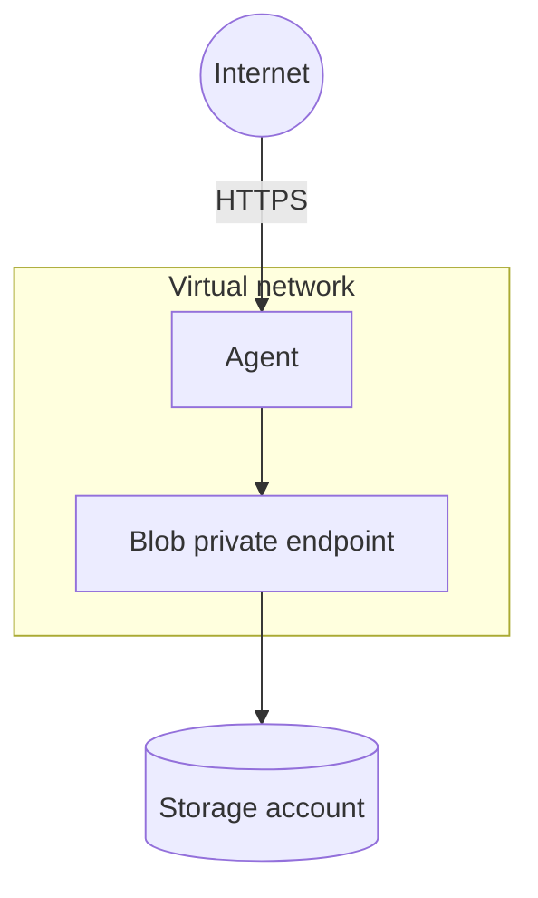

# Agent only

Deploys the GoRules Agent with its own storage. Use it when BRMS runs elsewhere.

- Virtual network with an apps subnet and a private endpoint subnet
- Storage account with a `rules` container, reached through a private endpoint
- Agent on Container Apps with an HTTPS address

## Architecture



## Requirements

- Azure CLI 2.61 or later
- GoRules Agent 2.0.2 or later
- Owner on the resource group. See [Requirements](../../README.md#requirements) for narrower roles.

## Deploy

Review `main.bicepparam` first. The example allows requests from any address.

From the repository root:

```bash
az group create --name rg-gorules-prod --location swedencentral

az stack group create \
  --name gorules \
  --resource-group rg-gorules-prod \
  --template-file main.bicep \
  --parameters examples/agent-only/main.bicepparam \
  --action-on-unmanage deleteAll \
  --deny-settings-mode none
```

## Verify

```bash
AGENT_URL=$(az stack group show --name gorules --resource-group rg-gorules-prod \
  --query outputs.agentUrl.value -o tsv)

curl $AGENT_URL/api/health
```

A successful deployment does not mean the Agent is healthy. If the health check fails, look at the revision and the logs:

```bash
az containerapp revision list --name gorules-prod-agent --resource-group rg-gorules-prod -o table
az containerapp logs show --name gorules-prod-agent --resource-group rg-gorules-prod --follow
```

## Publishing rules

The Agent loads releases from the `rules` container. Storage only accepts traffic through its private endpoint. A BRMS outside this deployment needs network access to it plus Storage Blob Data Contributor on the container. See [Publishing rules](../../README.md#publishing-rules).

If BRMS encrypts releases with `RELEASE_ZIP_PASSWORD`, give the Agent the same password. The template then also creates a Key Vault for it:

```bicep
param agentSecrets = {
  RELEASE_ZIP_PASSWORD: readEnvironmentVariable('RELEASE_ZIP_PASSWORD')
}
```

To evaluate a published decision:

```bash
curl -X POST $AGENT_URL/api/projects/<project-key>/evaluate/<decision> \
  -H "X-Access-Token: <project-access-token>" \
  -H "Content-Type: application/json" \
  -d '{"context": {}}'
```

## Outputs

| Name | Description |
| ---- | ----------- |
| `agentUrl` | Agent HTTPS address. |
| `agentPrincipalId` | Agent managed identity. |
| `storageAccountName` | Storage account. |
| `storageContainerName` | Container the Agent reads, `rules`. |
| `storageBlobEndpoint` | Blob service URL. |
| `keyVaultUri` | Key Vault URI, only with `agentSecrets`. |
| `vnetId` | Virtual network. |
| `environmentIp` | Container Apps environment IP. |
| `customDomainVerificationId` | Value for the `asuid` TXT record of a custom domain. |

## Cleanup

```bash
az stack group delete --name gorules --resource-group rg-gorules-prod --action-on-unmanage deleteAll
az group delete --name rg-gorules-prod
```

Deleting the stack takes about 30 minutes.

With `agentSecrets`, Azure keeps the deleted Key Vault for a while and its name can't be reused. See [Cleanup](../full-stack/README.md#cleanup) in the full-stack example.
